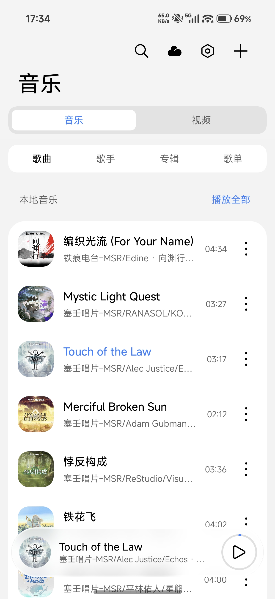
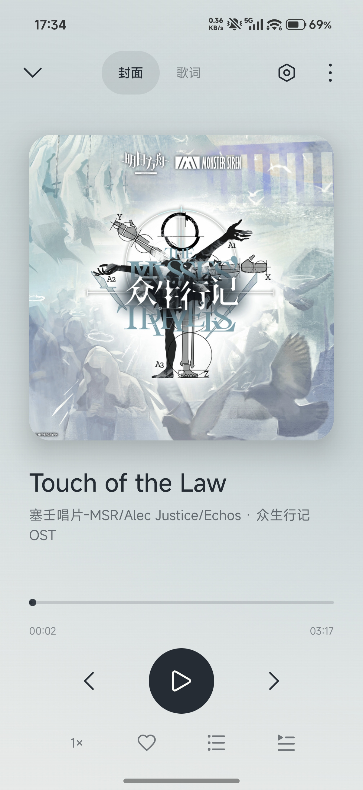
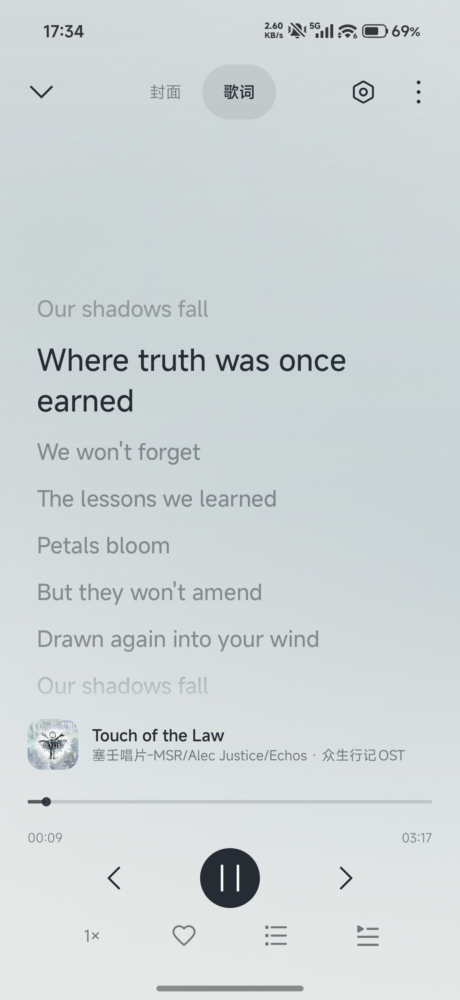
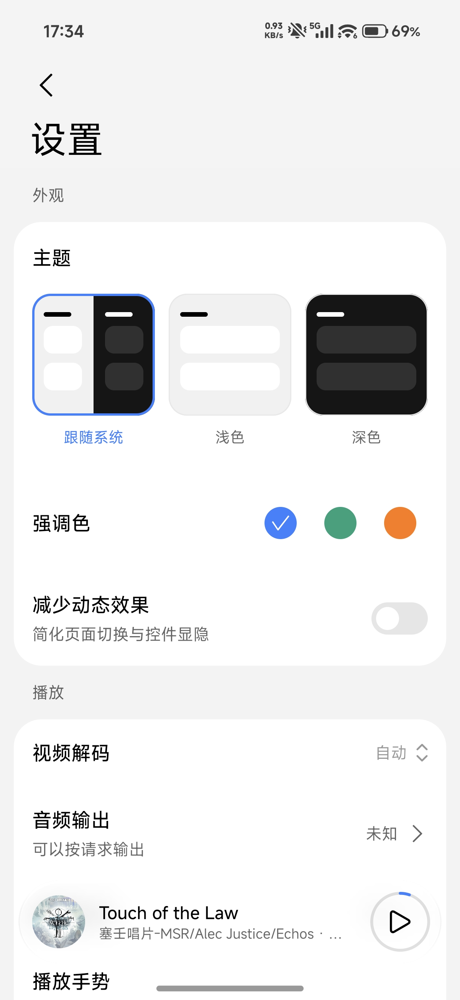
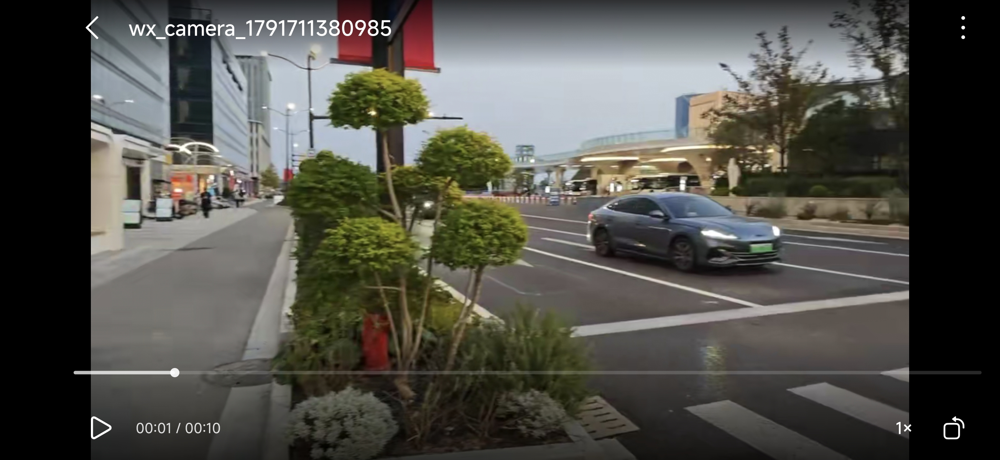
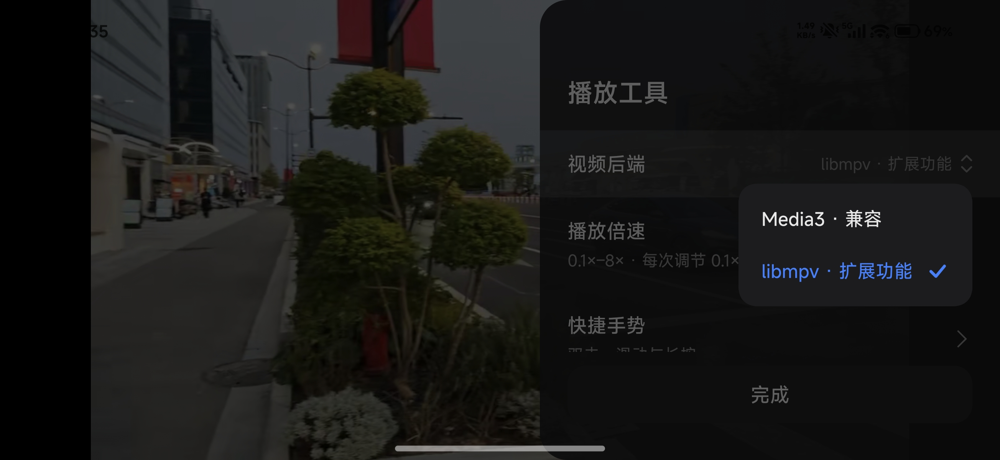

# YYPlayer for Android

使用Jetpack Compose前端框架、Miuix主题、libmpv/Media3后端框架编写的音频、视频二合一播放器。

当前版本 **0.1.7**（versionCode 8），支持 Android 8.0（API 26）及以上，提供 arm64-v8a / x86_64 独立安装包。

## 功能

### 软件本体

- 使用Miuix组件实现小米HyperOS风格的设计
- 按架构分包，Release 启用代码与资源压缩
- 支持明暗主题、强调色与减少动态效果；搜索和设置等页面可从播放栏原地展开、收回音乐详情

### 音频

- 本地音频支持系统通道与自研 AudioTrack 输出，可选择输出设备；独占／BIT_PERFECT 取决于系统和 USB 设备能力，不支持时明确提示，尚无端到端位准确认证
- 按歌曲、歌手、专辑和歌单管理音乐，支持收藏、队列排序、顺序／单曲／随机播放
- 通过自定义API接入网络音频提供商，流式播放或下载网络音频
- 支持双语歌词、歌词导入／联网获取、字号与间距调整；封面和歌词水平切换，元素依次跟随
- 通过 Android MediaSession 提供后台播放、系统媒体通知和播放控制，同步歌曲信息与封面；从控制中心打开当前歌曲进入封面页，退出封面返回首页

### 视频

- 参照了哔哩哔哩视频播放器的快捷手势，包括长按三倍速、双指缩放、快捷调整音量亮度等
- 可选择使用兼容性更好的Media3后端或功能更丰富的libmpv后端
- 0.1x-8x倍速播放
- 可添加字幕，使用libmpv时可以播放高级字幕

## 截图








## 构建与运行方式

使用 Android Studio 打开工程，配置 JDK 17 或更高版本、Android SDK 37、NDK 28.2.13676358 和 CMake 3.22.1。SDK 路径写入本地 `local.properties`。在项目根目录运行：

```powershell
./gradlew.bat assembleDebug
./gradlew.bat testDebugUnitTest lintDebug
./gradlew.bat assembleRelease
```

APK 位于 `app/build/outputs/apk/debug/` 或 `release/`，命名为 `YYPlayer_for_Android_0.1.7_<arch>_<debug/release>.apk`；手机通常选择 `arm64-v8a`，模拟器按实际架构选择。首次启动按向导导入音视频或授权音乐目录。

Release 需要使用自己的签名配置；未提供配置时产物未签名。与现有正式包签名不同时，可用 `-PdeviceQa=true` 构建共存的 **YYPlayer QA**，避免覆盖原有数据。详细步骤见[编译与签名](docs/BUILD_AND_SIGNING.md)，在线服务配置见[在线 API](docs/ONLINE_API.md)，验证范围与已知限制见[进度记录](docs/STATUS.md)。

## 致谢

- [Jetpack Compose / AndroidX Media3](https://developer.android.com/jetpack)：界面、媒体播放与系统媒体会话。
- [Miuix](https://github.com/compose-miuix-ui/miuix)：界面组件、图标与磨砂效果。
- [mpv](https://mpv.io/)、[FFmpeg](https://ffmpeg.org/) 和 [libass](https://github.com/libass/libass)：视频解码、播放与字幕能力。
- [libmpv-android](https://github.com/jarnedemeulemeester/libmpv-android)：Android libmpv 构建产物。依赖版本、许可与发布条件见 [ADR0007](docs/adr/0007-libmpv-video-adapter.md)。
