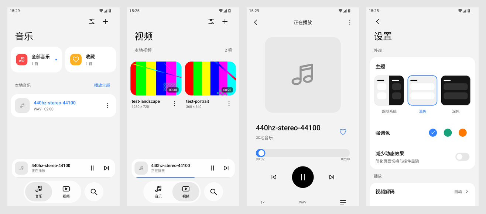

# U01：HyperOS 前端重写

此为视觉基线；窗口、图标、Activity及动画已由 [U02](UI_COMPONENTS_AND_MOTION.md) 更新。

用户在 2026-10-04 否定 E00 的前端表现，并提供 `references/` 下 11 张 HyperOS 4 截图以及只读参考工程 `E:\SourceFiles\androidstudio\Raidian`。本轮以这些材料重写前端；E00 的旧截图只作为历史播放证据，不代表用户认可当前视觉。

## 参考对应

- 文件管理器/相册：首页大标题、右上角动作、浅灰背景、白色圆角分组，媒体内容为主体；不再使用宣传语与大面积品牌渐变 Hero。
- 文件管理器/相册底部：带选中底块的磨砂悬浮双分页胶囊，加独立搜索圆按钮；正文从其后方滚动，尾部保留可滚动的安全距离。
- 相册设置：卡片外灰色分类标题，卡片内 17sp 主文字与 14sp 摘要，开关/导航箭头靠右。
- Raidian：Miuix TopAppBar、Scaffold、MiuixScrollBehavior、LayerBackdrop/textureBlur 的实际接法，以及手机/宽屏布局分离。只读参考布局和 API，不修改该工程，不复制其业务逻辑。

## 实现结构

| 文件 | 职责 |
| --- | --- |
| `ui/YYPlayerApp.kt` | 导航、持久偏好、异步导入与移除、收藏、播放命令、方向与主题 |
| `ui/HyperDesign.kt` | Miuix 组件适配、页面骨架、安全区域、导航、迷你播放器、统一线条图标 |
| `ui/HyperBackdrop.kt` / `ui/Api33MiuixBlur.kt` | API26 无 blur 类型 facade、API33+ 磨砂；见 ADR 0002 |
| `ui/LibraryScreens.kt` | 音乐分组列表、收藏过滤、本地搜索、视频缩略图网格、媒体选项 |
| `ui/MediaArtwork.kt` | 后台封面/视频首帧与元数据读取；URI 绑定、2 个工作槽、24 MiB 缓存、512px 图片上限；API26 视频使用图标回退 |
| `ui/PlayerScreens.kt` | 音乐播放、沉浸视频、进度与队列、倍速/方向/解码/媒体信息弹层 |
| `ui/SettingsScreen.kt` | 主题预览、强调色、减少动画、方向偏好与本次播放解码策略 |
| `ui/theme/Theme.kt` | 单一灰白/暗色调色板与大标题/正文排版 |
| `ui/VideoSurface.kt` | TextureView 的单一触摸协调、临时3×与连续变换 |

## 交互边界

- 首页保留音乐、视频两个分页；设置是顶栏入口，播放页由媒体/迷你播放器进入，不再把播放与设置塞进常驻四项底栏。
- 音乐封面、视频缩略图、艺术家、时长均来自实际 URI；没有数据时显示明确的图标/文字回退，不填假专辑和曲目。
- 添加文件后留在媒体库，用户点击才播放。移除只移出库，设备文件保留。收藏和外观选项持久化。
- 视频控制覆盖整幅画面，单击显示/隐藏，播放时自动收起；解码器与格式等技术信息进入菜单。长按3×结束/取消恢复基础速度，变换不因软硬解切换重置。
- API33+使用 Miuix RuntimeShader 磨砂，低版本使用不透明表面；不逐帧抓取视频作模糊，不用背景模糊代替媒体渲染。
- 横屏且宽度≥600dp的库页使用侧栏；音乐播放横屏分为封面与控件两列；设置内容限宽。系统栏 inset 分层处理，避免重复“额头”。

## 验收

构建/5 项单测/lint 通过；MuMu 上实际音乐/视频播放、导航/搜索/收藏/浅深主题、方向和真实软硬解检查完成。4 项设备测试通过，其中 3 项注入多点/长按事件检查实际 TextureView 矩阵和速度恢复。新截图在 `docs/validation/ui-v2/`，详情见 STATUS；最终审美反馈仍由用户给出。真机物理手势、低 API、release R8、USB HiFi/native 尚未验，不把 UI 重写当作这些能力完成。

