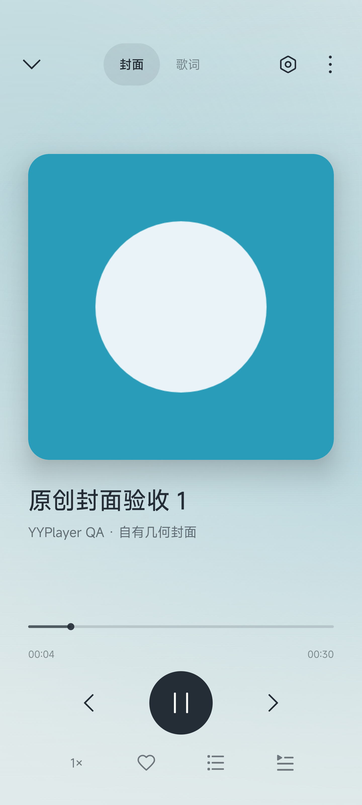
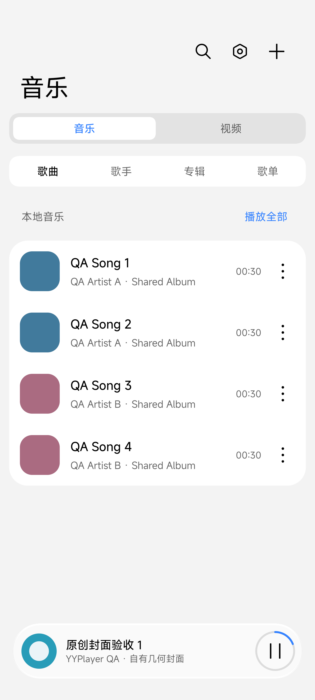

# U28：控制中心进入封面与返回首页

2026-10-15，dev 工作区，0.1.7／versionCode 8。小米 13 Ultra c9e352e3／2304FPN6DC／API36／HyperOS OS3.0.308.0.WMACNXM，1440×3200。使用自制 WAV／几何封面，保留原正式应用与数据。

## 根因与修改

实际右上角下拉后，第一次点歌曲打开系统媒体大卡片，再点歌曲才进入应用。修复前第二步只显示首页。入口探针 [intent-probe.txt](intent-probe.txt) 记录 MAIN 启动、flags 339738624、music=false、referrer=android-app://com.android.systemui。探针日志代码已移除。

MainActivity 在显式 open_music，或 SystemUI 来源的 MAIN／LAUNCHER 且已有当前音频时展开封面；媒体入口清除旧 music_on_back_stack，让返回收回首页。新 Intent 先 setIntent 再读 referrer，配置重建不重放原始命令。来源只作为导航提示，不用于授权或启动播放。普通桌面入口不强制展开。

Android Activity 的 [getReferrer 源码说明](https://github.com/aosp-mirror/platform_frameworks_base/blob/master/core/java/android/app/Activity.java)要求 onNewIntent 后先更新 Intent 再读取新来源，并指出来源不可信；本实现只改变现有媒体的页面展示。

## 命令和结果

- `./gradlew.bat assembleDebug assembleDebugAndroidTest -PdeviceQa=true --console=plain`：exit 0，见 build-qa.log、build-qa-final.log、build-qa-test-cleanup.log。
- `adb -s c9e352e3 install --no-incremental -r <按 output-metadata.json 选择的 arm64 QA APK>` 及测试 APK：Success，无卸载或清数据。
- `adb -s c9e352e3 shell am instrument -w -e class yy.daniel.yyplayerforandroid.MusicExperienceUiTest#controlCenterSongOpensCoverAndBackReturnsHome -e u07Evidence true yy.daniel.yyplayerforandroid.qa.test/androidx.test.runner.AndroidJUnitRunner`：exit 0，**OK (1 test)**，见 [device-after.txt](device-after.txt)。真实下拉、两步点击、封面、Back 首页、播放不中断。
- 同一直接 instrumentation 运行 `mediaEntryHandlesWarmIntentWithoutReplayingOnRecreationOrLauncher,platformNotificationPublishesArtworkAndControlsBackgroundPlayer`（各加相同类名前缀）：exit 0，**OK (2 tests)**，见 [device-cleanup-regression.txt](device-cleanup-regression.txt)。验证同 Activity 温启动、收起后重建、桌面来源不展开、旧返回标记清除，以及通知封面／后台控制／切歌／通知入口。
- `./gradlew.bat assembleDebug assembleRelease testDebugUnitTest lintDebug --console=plain`：最终 exit 0，见 [build-final.log](build-final.log)。[JVM](jvm-summary.json) 39／39；[lint](lint.txt) 0 errors／2 既有 warnings。
- `python scripts/Verify-MpvArtifact.py <APK> <report.json>`：4 个正式 ABI／类型 APK 全部 exit 0，每个 12 个 so 的 ELF 与未压缩 ZIP 条目满足 16KB 对齐；报告为本目录 *-native.json。未修改 native 库，不重复实际 libmpv 解码资格测试。
- `git diff --check`：exit 0。最终 QA 冷启动 Status ok、versionName=0.1.7、versionCode=8，见 [installed-launch.txt](installed-launch.txt)。正式 APK 与 QA SHA256／大小见 [artifacts.json](artifacts.json)；release 未用用户私钥签名。

## 失败记录与证据边界

device-before.txt 的一次点击只展开系统卡片，不能用于判定进入应用；device-before-card.txt 为补全两步后的修复前失败。device-final.txt 的三项组合测试中，控制中心用例通过，另外两项只在 ActivityScenario 清理时报 DESTROYED 超时；框架按初始 Intent 匹配生命周期。测试现在在所有功能断言完成后恢复初始 Intent，复测两项通过；不修改生产行为规避断言。

截图仅包含原创素材和 QA 库。实际操作通过系统 accessibility 定位原创歌曲标题，再执行真实 shell tap；没有只用 PendingIntent 代替控制中心点击。温启动与桌面来源测试是显式构造 Intent，和真实 SystemUI 操作分别记录。

其他 ROM、API26–32、进程死亡恢复、release 帧率、USB 输出资格未验；本次结果不扩大为所有系统兼容保证。未提交／推送，等待用户复核。
