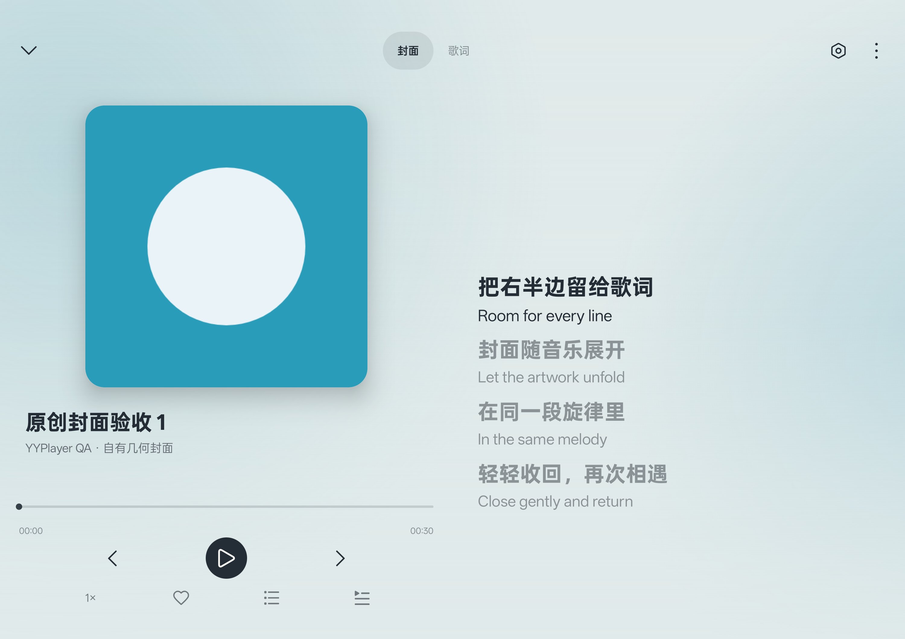
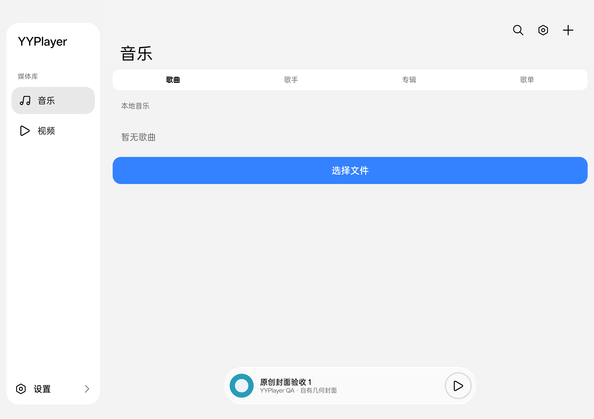

# U22／0.1.2：一加平板横屏修复（2026-10-15）

## 结果与环境

完成横屏音乐双栏、小封面闪现修复、libmpv 旋转视频比例修复、侧栏设置图标；版本为 0.1.2／versionCode 3。所有修改在 dev，未提交／推送／合入。接手时 master 为 `18fcb28`、dev 为 `31fece7`，两者内容相同，先切换 dev 再编辑。用户已提交 0.1.1；接手时另有未跟踪 U21 源码／测试／文档及 `app/release/` 用户产物，均保留，不能遗漏必要源文件或把签名产物一并提交。

- 设备：adb `bdba9db1`，OPD2404，API36，ROM `OPD2404_16.0.5.1201(CN01)`；用户说明为一加平板 Pro／8 Gen3／ColorOS16。横屏 3000×2120，density420。
- 原包 `yy.daniel.yyplayerforandroid` 保持 0.1.1／2；最终测试入口 `yy.daniel.yyplayerforandroid.qa` 为 0.1.2／3（YYPlayer QA debug）。全程 install -r，没有卸载或清数据。
- 输入：自制 WAV／几何封面／原创双语 LRC；圆形视频为 H.264 640×360 的 0°、90°、270°，以及 HEVC 编码 1440×2038／旋转 90°。没有保存个人视频画面。
- 用户指定 Record_2026-10-14-18-58-04 开头的录屏：仅通过 adb 流式读取 ffprobe 元数据，HEVC、1440×2038、旋转 90°、约 21.16 秒。不可 seek 的管道有 partial file 提示，因此不把帧率／完整解码当作该次元数据读取的证据；复现和像素断言全部用自制素材。

## 根因与实现

音乐横屏原先同时有左侧大封面和下方紧凑控制栏的 44dp 小封面。共享封面展开结束后，两者一起恢复可见，产生小封面闪现。现将封面、歌名、歌手·专辑、控制栏放在同一左列，右列歌词占完整高度；紧凑按钮尺寸与身份行可见性分离。完整歌词页仍保留身份行。U14 的展开／收回弹簧、共享封面终点绘制与按压动效保持不变；淡出的横屏分支不能覆盖当前锚点。

libmpv 已由 VO 应用旋转，旧页面却直接使用旋转前 `video-params/dw,dh`，把已转正的横屏图像再次套入竖屏比例。现优先读取 `video-out-params`（不存在时回退），按 `rotate` 为 90°／270° 交换宽高，发布已经转正的 VideoSize；不让 TextureView 再旋转一次。dw/dh 的像素比例修正不重复应用。契约依据：[mpv 0.41 输入属性](https://github.com/mpv-player/mpv/blob/v0.41.0/DOCS/man/input.rst)。

设置行在文字前绘制现有 `MiuixIcons.Regular.Settings`，整行点击与 24dp 图标保持一致。

主要文件：`MusicPlayerScreen.kt`、`HyperDesign.kt`、`MpvVideoBackend.kt`、`MpvVideoGeometry.kt`、`mpv_worker.cpp`、`app/build.gradle.kts`；测试为 `MusicExperienceUiTest.kt`、`VideoPhoneDeviceTest.kt`、`MpvVideoGeometryTest.kt`、`ReleasePackagingInstrumentation.java` 与 `scripts/Test-TabletAspect.py`。

## 实际验证

以下 Gradle／Python／adb 安装命令均 exit 0；instrumentation 另核对 `OK`／`PASS`，不只依赖 adb 进程退出码。

| 检查 | 结果与证据 |
| --- | --- |
| QA `assembleDebug assembleDebugAndroidTest testDebugUnitTest lintDebug -PdeviceQa=true` | 通过，[构建](u22-build-checks.log)；QA 标签替换使 lint 多 1 条 app_name 未使用警告 |
| 正式 `assembleDebug assembleRelease testDebugUnitTest lintDebug` | 双 ABI 产物成功，[构建](u22-production-build.log)；[39 项 JVM](unit-results.json) 全过；[lint](lint.txt) 0 error／2 warning（依赖版本提示、既有 MediaSession service 导出提示） |
| QA `assembleRelease -PdeviceQa=true` | R8／资源压缩通过，[构建](u22-qa-release-build.log)；独立副本用既有 debug 证书签名并通过 apksigner v2/v3 验签 |
| `ReleasePackagingInstrumentation` | 平板真实优化包 3 项通过：版本／启动、音频 JNI、mpv 原生解码；[输出](u22-release-smoke.txt)。这不等于完整 UI suite 在 release 上重跑 |
| 圆形视频专项 | 4 次 instrumentation，每次 Media3 AUTO、mpv AUTO、mpv SOFTWARE，共 12 组画面；全部通过 2.5% 圆形宽高容差，[像素测量](u22-aspect-suite.txt) |
| 音乐双栏专项 | 真实双语歌词、封面／控制栏在左、歌词全高、完整歌词页切换、3 次关闭／打开、动画期间无 compact identity、侧栏设置可见；[输出](u22-music-final.txt) |
| 原有封面回归 | 换曲时封面形状、按压变化、点击切换歌词通过；[输出](u22-cover-regression.txt) |
| 4 个正式 APK native 审计 | 每包 12 个 so；仅 arm64-v8a／x86_64；ELF 与未压缩 ZIP 16KB 对齐均通过。见本目录 native-*.json；release 库压缩，真实安装装载已过 |

比例修复前，同一个 90° H.264 自制圆在 Media3 为 648×649，在 mpv 为 **258×817（0.315789）**；修复后 mpv 为 **650×650（1.0）**。后续脚本重新生成的圆形半径略有不同，四组最终测量宽高比为 1.0000–1.0016，不拿不同素材像素直径比较性能。相同 HEVC 录屏规格的 mpv 自动／软件输出均为 825×824，状态显示 2038×1440。





APK 的包名、版本、大小和 SHA256 见 [artifacts.json](artifacts.json)。正式 release 产物未用用户私钥签名；QA release 只用于验证，不作为正式发布签名。

## 重跑方法

先安装按设备 ABI 选择的 `-PdeviceQa=true` debug APK 与普通 androidTest APK，再运行：

```powershell
python -X utf8 scripts/Test-TabletAspect.py --adb E:/DeveloperTools/AndroidSDK/platform-tools/adb.exe --serial bdba9db1
adb -s bdba9db1 shell am instrument -w -e class yy.daniel.yyplayerforandroid.MusicExperienceUiTest#tabletCoverKeepsControlsLeftAndLyricsFullHeight -e u07Evidence true yy.daniel.yyplayerforandroid.qa.test/androidx.test.runner.AndroidJUnitRunner
```

视频脚本只生成／覆盖 QA 私有外部目录中的自制 u22-circle.mp4；原始素材与截图在忽略的 build/u22-aspect 下。普通 suite 不带 `fixture=u22` 时跳过圆形专项，不能把任意彩条或个人视频当圆形素材测量。

发布包检查器需单独编译 `assembleDebugAndroidTest -PdeviceQa=true -PreleasePackagingQa=true`，签名 QA release 并 install -r 后运行 `.qa.test/yy.daniel.yyplayerforandroid.ReleasePackagingInstrumentation`；完成后恢复已保存的 QA debug／普通测试包。正式签名继续按 [构建说明](../../BUILD_AND_SIGNING.md)。

## 排查记录与限制

- 普通横屏 16:9 基线通过，加入真正的 display matrix 后才复现压缩。最初 FFmpeg 旧式 metadata 写法未生成旋转，已改为 `-display_rotation` 并用 ffprobe 确认，未将该次当作旋转测试通过。
- 首次音乐检查被新 QA 安装的首次设置页遮挡，断言失败；测试改为仅在 `.qa` 完成引导后通过真实底栏入口进入，未更改正式包偏好。
- 无测试失败遗留。视觉截图仅含原创素材；Compose 动画时钟与静态截图不证明 release 实时帧率／用户手感。未做完整大字体／TalkBack／分屏／API26–32、其他物理设备或音频硬件资格；不宣称视觉已经得到用户满意确认。
- 下一动作：用户可直接在平板 YYPlayer QA 复看布局与指定录屏；需要覆盖正式包时，用原用户签名构建 0.1.2。未经新的明确授权，不自动提交／推送／合入。
