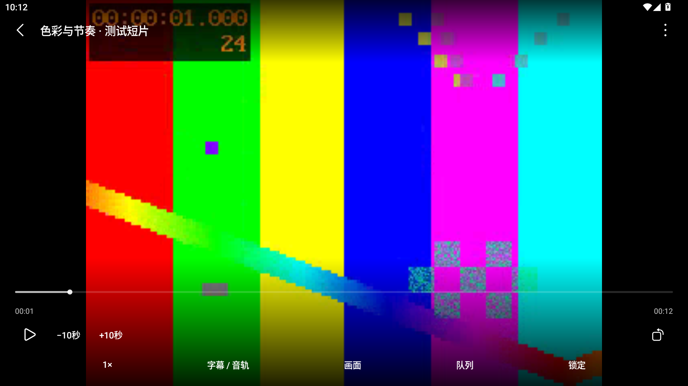
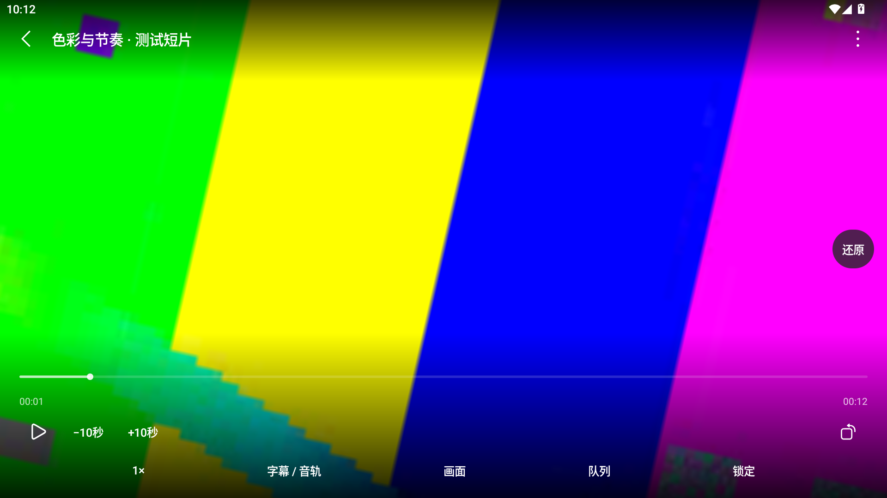

# U15 视频验收

日期：2026-10-14。分支 dev，未提交。状态：本轮实现和 MuMu 专项通过；物理设备手感及桌面完整功能对等仍 Partial。功能差异见 [视频体验](../../UI_VIDEO_EXPERIENCE.md)。

设备先 `adb devices -l` 得到空列表，再通过已安装 MuMuManager `info --vmindex all` 取得运行实例的 `127.0.0.1:16384`，连接后枚举成功：MuMu Android 15／API35，报告 model 2304FPN6DC，物理尺寸 1080×1920。这不是有线小米 13 Ultra 的真机证据。

素材：`app/src/androidTest/assets/v15-video.mp4`，FFmpeg 9.0.1 lavfi testsrc2 320×240／24fps／12s，libx264 ultrafast／CRF32、两个低幅 AAC 音轨（440Hz／660Hz，volume 0.01、24k）、英语内嵌 mov_text 字幕。由本项目生成，无用户媒体。另用应用缓存中的自制 SRT／VTT 字符串验证字幕。MuMu fingerprint：`Xiaomi/ishtar/ishtar:15/V417IR/1100:user/release-keys`。

- 最终主 APK SHA256：`4AE1D6F25DB8DA4DB86E9B2D353CB09BF70D0508BEABEF56537E4B97923B1FD7`。
- 4:3 样片 SHA256：`886201DDE13B688FC5D8DE83600D80AF4AEB03D75DF13B46B73F78AC259CCB99`。

验证命令：

```powershell
.\gradlew.bat :app:assembleDebug :app:assembleDebugAndroidTest :app:testDebugUnitTest :app:lintDebug --no-daemon --max-workers=4
adb -s 127.0.0.1:16384 install -r app/build/outputs/apk/debug/app-debug.apk
adb -s 127.0.0.1:16384 install -r app/build/outputs/apk/androidTest/debug/app-debug-androidTest.apk
adb -s 127.0.0.1:16384 shell am instrument -w -r -e class yy.daniel.yyplayerforandroid.VideoUpgradeDeviceTest,yy.daniel.yyplayerforandroid.VideoSurfaceGestureTest,yy.daniel.yyplayerforandroid.VideoPlayerUiTest,yy.daniel.yyplayerforandroid.MusicUpgradeDeviceTest yy.daniel.yyplayerforandroid.test/androidx.test.runner.AndroidJUnitRunner
```

首轮 10 项通过后，新增 4:3 真实像素回归发现暂停纹理的画面未随矩阵刷新。修复同时 invalidate 纹理和 AndroidView 宿主，确保无新视频帧时也提交变换。最终像素测试证实原黑边处由黑色变为视频彩色像素，还原后重新成为原比例黑边。

| 检查 | 结果 |
| --- | --- |
| assembleDebug／assembleDebugAndroidTest／testDebugUnitTest／lintDebug | exit 0；37 JVM，无失败／跳过；lint 0 error、2 既有 warning（NewerVersionAvailable、ExportedService） |
| 清理旧 PlayerView XML 后重新打包／lint | exit 0，无新增 unused resource warning |
| install -r 主／测试 APK | exit 0，Success；无卸载或清除数据 |
| VideoUpgradeDeviceTest | 5 通过：真实音轨／字幕、重建保留、外置 SRT cue 与旧 generation 拒绝、A–B 至少三次回绕、boost token、SRT／VTT 校验 |
| VideoSurfaceGestureTest | 4 通过：矩阵、长按恢复、移除取消、停止重入保留 |
| VideoPlayerUiTest | 3 通过：面板、黑边像素／还原／锁定、360dp 宽约束＋200% 字体操作可达 |
| MusicUpgradeDeviceTest | 5 通过，既有音乐真实播放回归 |

总计 `OK (17 tests)`，原始输出：[device-tests.txt](device-tests.txt)。Android instrumentation 的完成标记 `INSTRUMENTATION_CODE: -1` 为正常结束；同时检查 OK，而非只看 adb 进程 exit。

仅保存两张必要画面，来自 Compose 测试宿主和自制素材，保留状态栏不代表生产 PlayerActivity 的沉浸窗口行为：

| 原比例与细进度条 | 放大旋转覆盖黑边＋还原 |
| --- | --- |
|  |  |

未验条件：生产 Activity 沉浸切换／系统选择器截图保存的完整手工流程、实体手机双指手感、触感马达、API26–32、系统级大字体／TalkBack、release 帧率／功耗、HDR、复杂 ASS 特效；不将 MuMu 或约束布局测试当作这些资格的替代。视觉满意度等待用户复核。
